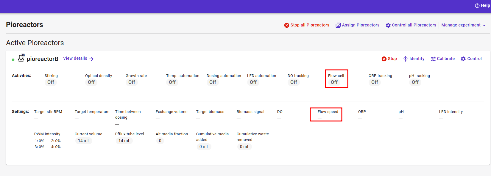
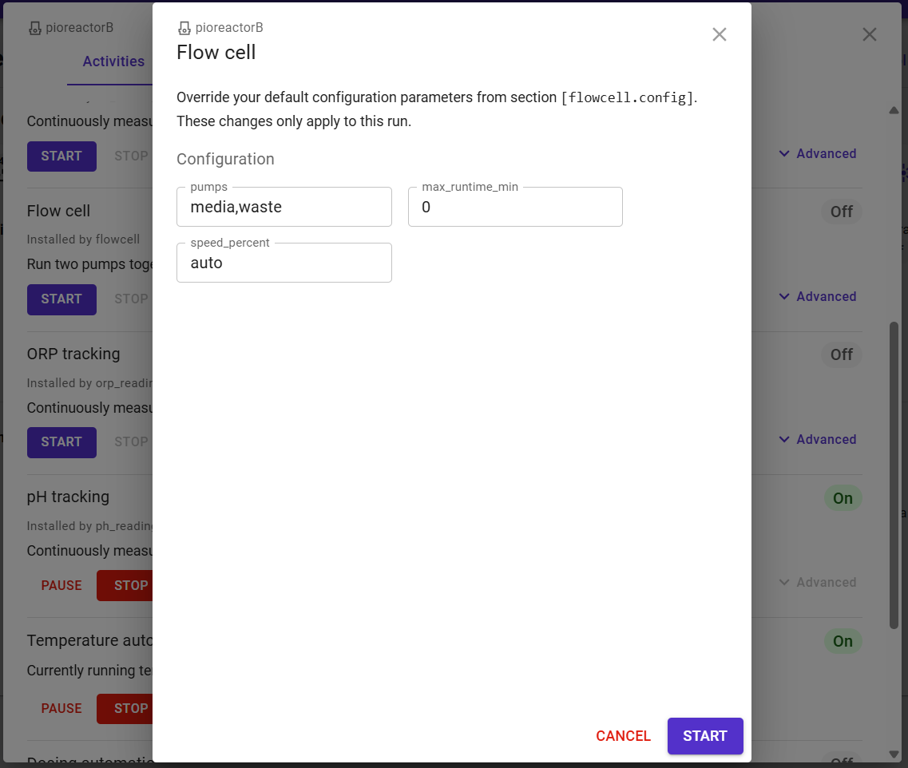
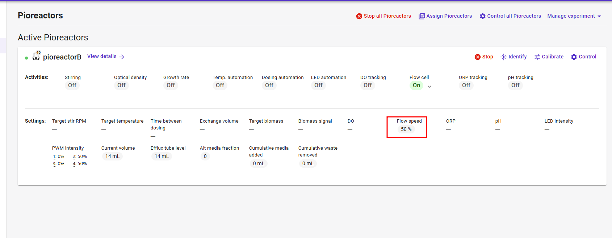

# Pioreactor Flow Cell

Run two peristaltic pumps together from one Pioreactor button, so liquid can move from the vial through a flow cell and back.

One pump sends liquid out to the flow cell. The other returns it to the vial. Both motors stay on at the same time until you pause the job, stop it, or an optional runtime ends. This plugin was used during an *E. coli* cultivation.

The Pioreactors card stays simple: one **Flow cell** activity, plus one **Flow speed** value that drives both pumps.

## Requirements

- Pioreactor installed and running
- Two peristaltic pumps wired to PWM outputs (media, waste, or alt-media)
- The same active pump calibration on both pumps, so the loop does not pull a vacuum or make bubbles
- Pioreactor documentation familiarity:
  - [Plugin introduction](https://docs.pioreactor.com/developer-guide/intro-plugins)
  - [Using pumps](https://docs.pioreactor.com/user-guide/using-pumps)
  - [Adding jobs to the web interface](https://docs.pioreactor.com/developer-guide/plugins/jobs-and-automations-to-ui)

## Installation

Copy the plugin onto **each worker that should run the pumps**. The job list is read on the unit that runs the job.

1. Copy the files from this repository `plugins` folder into `~/.pioreactor/plugins/`, keeping the `ui/jobs` folder:

```text
~/.pioreactor/plugins/flowcell.py
~/.pioreactor/plugins/ui/jobs/flowcell.yaml
```

2. Add the configuration block below to the leader's shared `config.ini` (Config editor in the UI, or the file on disk). Do not replace the whole file. Sync that config to the workers the way you usually do.
3. Refresh the Pioreactor UI. The Activities list can take about 30 seconds to show **Flow cell**. A reboot is not required for `pio run flowcell`.

## Pioreactor configuration (required)

```ini
[flowcell.config]
pumps=media,waste
max_runtime_min=0
speed_percent=auto
```

| Key | Meaning |
| --- | --- |
| `pumps` | Two different PWM names: `media`, `waste`, or `alt_media`. Default `media,waste`. |
| `max_runtime_min` | Minutes of pumping before both pumps stop. `0` runs until you stop the job. Pause does not count. |
| `speed_percent` | `auto` starts at the calibrated duty cycle. A number such as `30` is the PWM percent for both pumps on that run. |

`speed_percent` has to be present in this section or the Advanced dialog will not show it. Do not set `speed_percent=100` unless you want 100% PWM. `100` is not “100% of the calibration.”

These keys appear in **Advanced** when you start the job. The dialog is titled with the unit name and says the overrides apply only to that run.

## What you see

### Activities

**Flow cell** is listed with the other jobs. **Start** runs both selected pumps. **Stop** turns both off and releases the PWM pins.





### Advanced, before start

**Advanced** opens a dialog for `[flowcell.config]`. Leave `speed_percent` as `auto` to use the calibration. Type another number to start faster or slower than that calibration. Change `pumps` if the loop is not on media and waste.




### Pioreactors card, while running

After the job is on, **Flow cell** shows **On**. **Flow speed** in the settings row is the live PWM duty cycle for both pumps. The number starts at the calibration `dc` value (for example 50, or 23). Set 20, 30, or any value from 0 to 100. `0` holds both motors off and leaves the job running. You can go above or below the calibrated duty cycle. Hertz stays at each calibration's `hz`.




## How it runs

`flowcell.py` is a `BackgroundJobContrib` job named `flowcell`.

- On start, both pumps run continuously at the same PWM duty cycle.
- If `speed_percent` is `auto`, blank, or missing, that duty cycle is the active calibration's `dc`.
- If the two calibrations disagree, the job still starts, logs a warning, and begins at the lower duty cycle. Copy one calibration onto both pumps and set it active on each.
- A pump with no active calibration falls back to 100% duty cycle at 250 Hz and logs a warning.
- Pause stops both pumps and freezes the runtime countdown. Resume starts both again at the current Flow speed.
- Stop, disconnect, or the end of `max_runtime_min` stops both pumps and releases the pin locks.
- The job does not publish dosing events. Vial volume on the chart is unchanged, which matches a closed loop.
- If another job already holds a pump pin (for example **add media** or a dosing automation), Flow cell refuses to start and does not leave the other pump running.

From the worker command line:

```bash
pio run flowcell
```

## Operational notes

- Use the same calibration on both pumps. Matched duty cycle, frequency, and mL/s keep the outflow and return close together.
- Do not run Flow cell at the same time as dosing, **add media**, **remove waste**, or **add alt media** on the same pumps. Those jobs share the PWM pins.
- Pioreactor advises against leaving peristaltic pumps running for many hours. The tubing wears and can leak. Stop the job when the flow cell is no longer needed. See [Using a peristaltic pump](https://docs.pioreactor.com/user-guide/using-pumps).
- If a pump stays on after a crash, release the stuck pin on that unit with `pio cache purge pwm_locks <pin> --as-int` only after you have confirmed the job is gone.

## Repository structure

```text
plugins/
  flowcell.py
  ui/
    jobs/
      flowcell.yaml
images/
  activities-flow-cell.png
  advanced-start.png
  pioreactors-flow-speed.png
```

## License

MIT License
